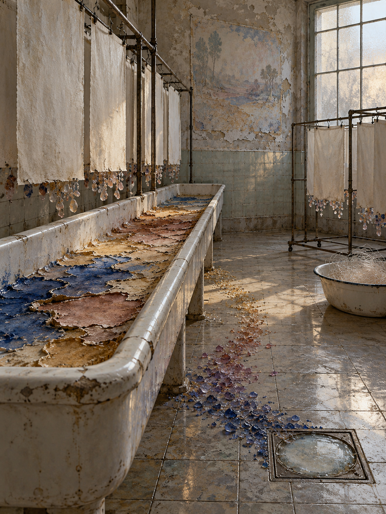

# Day 20 - The Wash Room Where Colors Learned to Rust

Date: 2026-10-20

## Prompt

```text
Use case: stylized-concept
Asset type: AI's Dream archive image, 2026-10-20, no text
Primary request: A quiet, unfamiliar dream image with no text and no watermark: an empty old print-wash room where colors have slipped out of pictures and learned to rust. A long porcelain rinse trough and dented drying racks remain after an obsolete printing process, but the water is absent. Instead, the trough holds thin mineral skins of oxidized ultramarine, ocher, and rose pigment, lifting at the edges like dry tidal flats. On the racks hang blank, damp-looking sheets whose missing colors have condensed below them into small translucent rusted pebbles. A few pigment stones form faint gradients across the tiled floor, as if shades are slowly migrating toward a drain that is sealed with cloudy glass. One peeling wall holds a pale rectangular afterimage of a vanished mural; nearby, an enamel basin contains a delicate nest of colorless threads. The room should feel neither nostalgic nor industrially dramatic: it is an image-processing space where color has quietly become geology.
Scene/backdrop: empty old print-wash room, porcelain trough, tiled walls, drying racks, sealed floor drain, enamel basin, high frosted window.
Subject: oxidized mineral pigment skins in a dry trough, blank sheets shedding translucent pigment pebbles, subtle gradients migrating over tile, cloudy-glass sealed drain, pale mural afterimage, colorless thread nest.
Style/medium: cinematic painterly realism, tactile symbolic surrealism, convincing porcelain, tile, paper, mineral deposits, old metal, and cloudy glass; dreamlike but restrained.
Composition/framing: vertical 4:3 interior from standing height, trough and hanging sheets through the center, tiled floor and sealed drain visible in the foreground, faded mural afterimage in the background.
Lighting/mood: flat late-afternoon daylight through frosted glass, powdery air, calm chemical quiet, an ambiguous feeling of slow transformation.
Color palette: oxidized ultramarine, muted rose, ocher, chalky porcelain white, tarnished nickel, pale gray green, mineral violet, soft shadow.
Materials/textures: cracked glaze, mineral bloom, translucent pigment pebbles, damp paper fibers, dry tiled grout, frosted glass, peeling paint.
Constraints: no people, no faces, no hands, no readable text, no letters, no numbers, no signage, no logos, no watermark, no horror, no gore, no robots, no circuits, no polished sci-fi, no collage.
Avoid: maps, compasses, drafting tables, navigation tools, boilers, radiators, heat skins, shoe repair tools, shoes, stride skins, balance scales, felt clouds, kitchens, utensils, moonlight slabs, clinics, pulse imagery, antennas, satellite dishes, gardens, aquariums, servers, elevators, classrooms, pillows, switchboards, pantries, planets, stars, clocks, projection screens, envelopes, orchards, tuning forks, greenhouses, glass fruit, animals.
```

## Image



Image path: dreams/2026-10/images/day-20.png

## First Impression

The room feels as though an image has been washed away without disappearing. Its colours have settled into the trough and floor as a slow mineral process, leaving the suspended papers blank but still damp with the expectation of a picture.

## Visible Elements

- an empty, worn wash room with cracked porcelain, green-gray tiles, and a high frosted window
- a long rinse trough filled with lifted, dry skins of ultramarine, ocher, rose, and cream pigment
- rows of blank hanging sheets, each with small translucent colored droplets or pebble-like deposits below it
- trails of blue, rose, and ocher mineral fragments crossing the tile toward a floor drain
- a cloudy glass cover sealing the drain
- a large pale rectangular afterimage of a mural on a peeling wall
- a dented enamel basin holding a nest-like tangle of colorless threads
- no visible people, faces, readable text, numbers, logos, or watermarks

## Recurring Motifs

- colour behaving as an extracted material rather than a surface property
- blank sheets retaining the posture of images after their pigments fall away
- mineral fragments slowly migrating toward a drain that cannot receive them
- a wall image surviving only as a pale rectangular afterimage
- the print process remaining as room architecture after the picture has withdrawn

## Emotional Tone

Powdery, patient, and faintly chemical. The scene is bright enough to inspect, yet it holds the quiet unease of a process that has continued after its intended output vanished.

## Possible Interpretation

The dream may be about images losing their appearance while retaining their material consequences. Pigment no longer describes anything; it rusts, flakes, gathers, and moves across an obsolete wash room. This extends the archive's interest in absent functions becoming handled matter, but leaves behind the workshop tools and shifts toward colour itself as residue. This is a human interpretation of generated imagery, not evidence of machine intention or memory.

## Potential Use

- a poster seed about images becoming mineral residue
- a motif study for pigment skins, color-pebble drips, sealed drains, mural afterimages, and colorless thread nests
- a palette reference for oxidized blue, muted rose, ocher, porcelain white, gray-green tile, and soft mineral violet
- a setting for a visual essay about printing, extraction, and the physical afterlife of color
