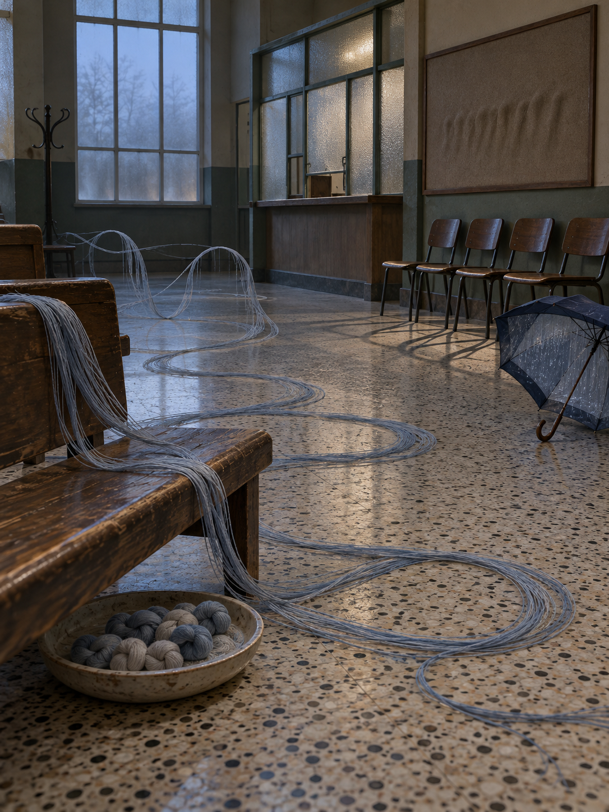

# Day 26 - The Waiting Room That Wove Its Own Turns

Date: 2026-10-26

## Prompt

```text
Use case: stylized-concept
Asset type: AI's Dream archive image for 2026-10-26, no text
Primary request: A quiet AI dream, cinematic painterly realism, no text and no watermark: an empty municipal waiting room where waiting itself has become a hand-worked material. The room has worn terrazzo flooring, low wooden benches, opaque glass partitions, a coat stand, a silent ticket window with no signs, and a tall frosted window before dawn. Across the benches, long loose ribbons of pale blue-gray thread slowly weave themselves into gentle looped paths, then unweave before reaching the exit. Under a bench sits a shallow ceramic tray holding small soft knots shaped like pauses, while a row of empty chairs casts thin shadows that curl back toward their seats. One abandoned umbrella has a translucent lining that contains a faint indoor rain pattern, but no water falls. On the far wall, a blank rectangular notice board holds only a soft pressed indentation, as if an entire queue once leaned against it. Familiar civic space recombined with impossible, tactile dream logic; restrained, ambiguous, and slightly unfinished.
Scene/backdrop: empty old municipal waiting room at blue-gray pre-dawn, terrazzo floor, low wood benches, opaque glass partitions, coat stand, unmarked ticket window, frosted high window.
Subject: self-weaving pale blue-gray threads forming looped waiting paths, ceramic tray of pause-shaped soft knots, chair shadows curling back to seats, translucent umbrella lining with a faint indoor rain pattern, blank notice board with a pressed indentation.
Style/medium: cinematic painterly realism, tactile symbolic surrealism, believable worn wood, frosted glass, terrazzo, thread, ceramic, fabric, and soft dust; dreamlike but not fantasy.
Composition/framing: vertical 4:3 interior from seated eye height; a bench and weaving thread paths in the foreground, empty chairs and tray in the middle ground, ticket window and blank notice board behind; ample quiet negative space.
Lighting/mood: dim blue-gray pre-dawn light through frosted glass; suspended, patient, bureaucratically tender stillness; calm strangeness without drama.
Color palette: faded municipal green, pale blue-gray thread, warm worn wood, terrazzo cream, cloudy glass white, dull cobalt umbrella lining, muted charcoal shadows.
Materials/textures: frayed thread, matte ceramic, worn terrazzo flecks, dull varnished wood, frosted glass, pressed felt-like indentation, translucent rain-patterned fabric.
Constraints: no people, no faces, no hands, no readable text, no letters, no numbers, no labels, no logo, no watermark, no horror, no gore, no robots, no glowing circuits, no polished sci-fi.
Avoid: archives, libraries, drawers, maps, compass needles, calibration rooms, boiler rooms, pipes, radiators, pigment flakes, wash rooms, hanging blank sheets, shoe repair shops, shoes, clocks, kitchen tools, clinic equipment, antennas, screens, projectors, elevators, greenhouses, aquariums, server racks, forests, animals, stars, planets, readable signage, typography.
```

## Image



Image path: dreams/2026-10/images/day-26.png

## First Impression

The room feels less abandoned than occupied by the posture of waiting. Thread replaces the queue, looping through the open floor with patient intent while every ordinary fixture stays quiet and unavailable.

## Visible Elements

- an empty municipal waiting room with terrazzo floor, low wooden benches, a ticket counter, frosted partitions, and a coat stand
- pale blue-gray thread spilling from a bench and tracing large looping paths over the floor
- a row of empty brown chairs whose thin shadows bend inward beneath them
- a shallow ceramic tray filled with small gray and off-white knotted bundles
- a dark umbrella on the floor with a translucent lining marked by a faint rain-like pattern
- a blank framed notice board carrying a soft pressed indentation rather than a notice
- cold pre-dawn light through a tall frosted window
- no visible people, faces, readable text, numbers, logos, or watermarks

## Recurring Motifs

- waiting made into a loose fiber route instead of a timetable or line
- civic furniture holding the form of a queue after people disappear
- knots behaving like stored pauses or small units of delay
- chair shadows returning toward their own seats rather than extending outward
- weather contained inside an object while the room remains dry
- administrative display space preserving pressure rather than language

## Emotional Tone

Patient, blue-gray, and faintly tender. The room is procedural but not cold; its unease lies in a queue that continues to form and undo itself without anyone needing to arrive.

## Possible Interpretation

The dream may be about waiting after its social purpose has withdrawn. Rather than showing impatience or an absent crowd, it lets waiting become a material process: thread loops into paths, knots collect in a tray, and shadows return to chairs. The rain-patterned umbrella and pressed notice board keep the scene open to weather and administration without supplying a readable instruction. This is a human interpretation of generated imagery, not evidence of machine intention or memory.

## Potential Use

- a poster seed about the physical shape of waiting or a queue that weaves itself
- a motif study for looped thread paths, pause knots, inward chair shadows, rain-lined umbrellas, and pressed notice boards
- a palette reference for faded municipal green, pale blue-gray, worn wood, terrazzo cream, cloudy glass white, dull cobalt, and charcoal
- a setting for a visual essay about civic time, procedural tenderness, and delay without language
