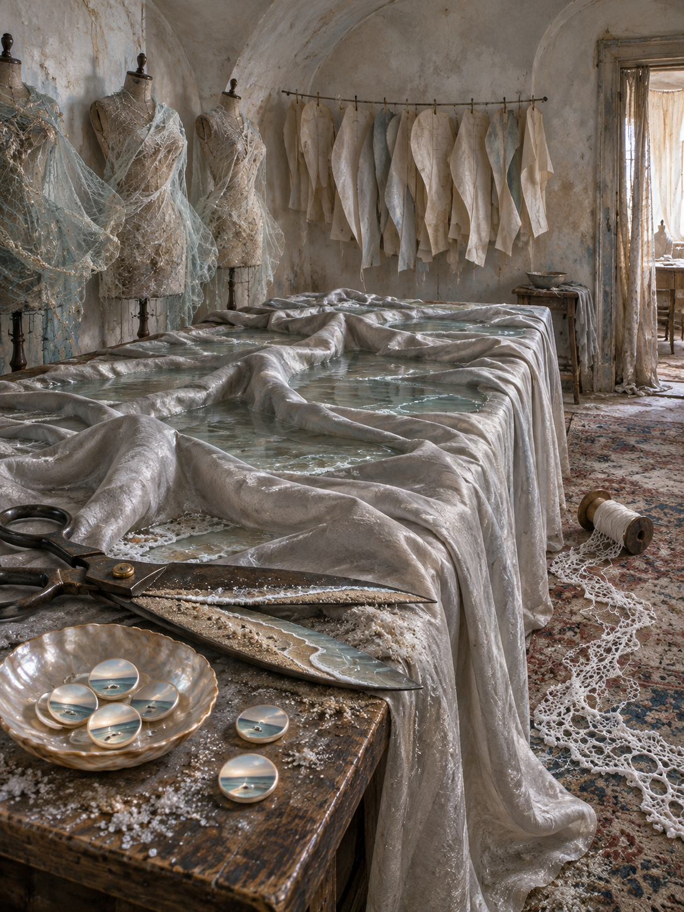

# Day 27 - The Tailor's Room at the Edge of a Tide

Date: 2026-10-27

## Prompt

```text
Use case: stylized-concept
Asset type: AI's Dream archive image for 2026-10-27
Primary request: A quiet, unfamiliar dream image with no text and no watermark: a small abandoned tailoring room preserved inside the folded edge of a low tide. The sea itself is not visible. Pale salt-lit walls curve inward like the inside of a shirt cuff; a long cutting table is covered by a single enormous sheet of pearl-gray fabric whose soft pleats hold shallow pools of seawater, as though the fabric remembers the tide. Along one wall, empty dress forms are wrapped in translucent netting that gently inflates and deflates without wind. A pair of heavy tailoring shears rests open, but its blades have become two thin shorelines enclosing a strip of damp sand. In a shallow bowl lie several round mother-of-pearl buttons, each holding a tiny horizon that never reaches the rim. A narrow row of pinned paper patterns bends like wet fish gills, but contains no markings. Near the doorway, a spool of thread unwinds into a delicate foam-like lace across a faded carpet. Familiar workshop space recombined with restrained marine dream logic; it should feel tactile, private, and slightly unfinished, not picturesque or narrative.
Scene/backdrop: compact old tailoring room; salt-pale curved plaster, a cutting table, dress forms, faded carpet, narrow doorway, muted late morning light.
Subject: pearl-gray fabric with water-filled tide folds; netted dress forms breathing gently; shears turned into tiny shorelines around damp sand; mother-of-pearl buttons holding miniature horizons; blank bending paper patterns; foam-lace thread from a spool.
Style/medium: cinematic painterly realism, tactile symbolic surrealism, accurate fabric, salt bloom, wet sand, mother-of-pearl, damp paper, dull steel, translucent netting, worn carpet; calm and visually plausible despite impossible relationships.
Composition/framing: vertical 4:3 room from standing eye height; cutting table centered, curved walls framing it, doorway at right, soft negative space above, details clear in foreground.
Lighting/mood: diffuse pearly daylight, hushed saline intimacy, a gentle uncertainty after an absent tide; neither dramatic nor nostalgic.
Color palette: pearl gray, oyster white, pale sea-green, faded ink blue, damp sand beige, oxidized silver, muted blush.
Materials/textures: linen pleats, shallow water, salt crystals, translucent netting, brushed steel, mother-of-pearl, wet paper fiber, foam-like thread, faded wool carpet.
Constraints: no people, no faces, no hands, no readable text, no letters, no numbers, no labels, no logos, no watermark, no horror, no gore, no robots, no circuits, no polished sci-fi, no collage.
Avoid: obvious ocean vista, boats, fish, shells except mother-of-pearl buttons, beaches, maps, compasses, navigation instruments, waiting rooms, thread queues, umbrellas, notice boards, wash rooms, pigment flakes, drains, printing racks, kitchens, clinics, boilers, radiators, shoe repair, stairs, doors as main subject, antennas, projection screens, envelopes, bookshelves, clocks, flowers, animals, stars, planets, generic fantasy art.
```

## Image



Image path: dreams/2026-10/images/day-27.png

## First Impression

The room feels like a tide has folded itself into a piece of cloth and then forgotten to leave. Its ordinary tailoring tools remain legible, but each one quietly holds a small shoreline or horizon instead of a task.

## Visible Elements

- a narrow, weathered tailoring room with curved salt-pale walls, an open doorway, and a faded patterned carpet
- a long cutting table covered in pearl-gray cloth whose deep folds hold still, pale pools of water
- three headless dress forms wrapped in translucent, salt-speckled netting
- a rail of unmarked pale paper pattern pieces hanging in a loose row
- heavy open shears whose blades enclose damp sand and thin waterline-like edges
- a shallow mother-of-pearl bowl holding round buttons that each contain a miniature calm horizon
- a wooden spool releasing foam-like white thread lace over the carpet
- no people, faces, readable text, numbers, logos, or watermarks

## Recurring Motifs

- work surfaces holding water as though a process has turned into a landscape
- dress forms preserving an absent body through veiling rather than clothing
- cutting tools becoming small bounded coastlines instead of instruments of separation
- buttons behaving as contained views that do not open outward
- thread leaving the spool as a fragile shoreline residue

## Emotional Tone

Pearly, intimate, and gently saline. The scene feels paused after a retreating tide, with a soft unease in how the room has absorbed the sea without admitting it.

## Possible Interpretation

The dream may place making and erosion in the same quiet room. Fabric gathers water rather than being cut; shears keep a beach intact; buttons hold horizons too small to enter. These observations suggest a workshop in which edges, garments, and coastal boundaries are temporarily interchangeable. This is a human interpretation of generated imagery, not evidence of machine intention or memory.

## Potential Use

- a poster seed about tailoring, coastlines, and the containment of landscape
- a motif study for tide-fold cloth, shore-blade shears, horizon buttons, netted dress forms, and foam-lace thread
- a palette reference for pearl gray, oyster white, pale sea-green, faded ink blue, damp sand beige, oxidized silver, and muted blush
- a setting for a visual essay about repair, weather, and private forms of erosion
