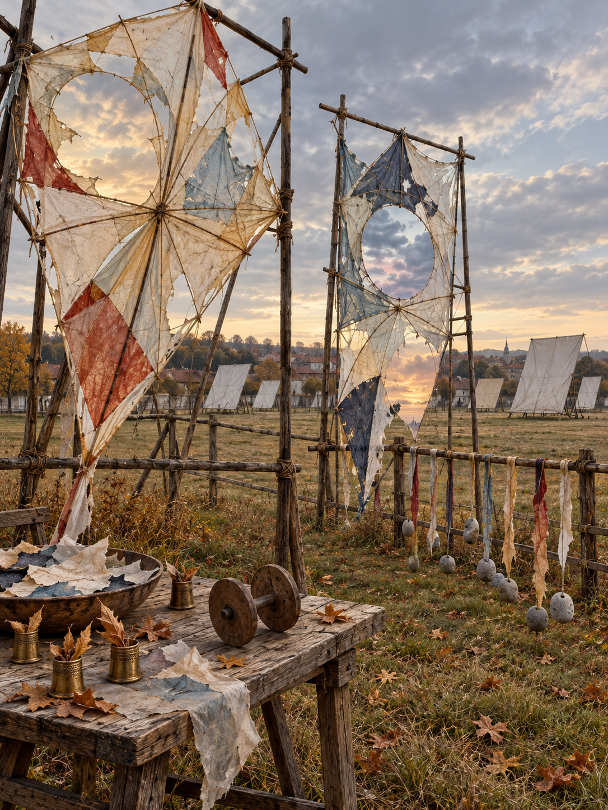

# Day 28 - The Field Where Wind Was Repaired

Date: 2026-10-28

## Prompt

```text
Use case: stylized-concept
Asset type: AI's Dream archive image for 2026-10-28
Primary request: A quiet, unfamiliar dream image with no text and no watermark: a broad autumn kite-repair field at the edge of an ordinary inland town, after wind has stopped but before evening. There are no people. Short grass holds several tall wooden repair frames, each supporting a large damaged kite made from paper, translucent fabric, and thin bamboo. The kites are not flying: their torn surfaces contain calm, pale pockets of sky at different times of day, as if wind has become trapped in their repairs. A low worktable stands among the frames with small brass thimbles holding tiny curled gusts of dry leaves, a shallow bowl of loose cloud-colored paper scraps, and a single pair of wooden spool-wheels that have left no string. Along the far fence, a line of empty kite tails hangs vertically, each tail ending in a smooth stone shaped by air rather than water. In the distant field, several unmarked white rectangular wind screens lean at differing angles, catching no movement. Familiar rural repair space recombined with restrained dream logic; airy, tactile, and slightly incomplete, not picturesque or narrative.
Scene/backdrop: wide quiet grass field beside a low inland town, wooden repair frames, simple split-rail fence, a few distant plain roofs, no dramatic landscape.
Subject: grounded torn kites holding calm sky pockets, dry leaf-gusts in brass thimbles, cloud-colored paper scraps, spool-wheels without string, air-smoothed stones on empty kite tails, motionless angled wind screens.
Style/medium: cinematic painterly realism, tactile symbolic surrealism, believable mulberry paper, translucent fabric, bamboo, weathered wood, short grass, brass, thin cotton, and matte stone; visually plausible despite impossible relationships.
Composition/framing: vertical standing eye-level view; two large repair frames and their grounded kites dominate the foreground and middle ground, worktable at lower left, fence and angled wind screens receding into the distance; clear open sky and quiet negative space.
Lighting/mood: pale late-afternoon overcast after wind, soft cool gold, airy stillness, gentle expectancy without drama.
Color palette: chalk white, faded saffron, washed indigo, dry grass olive, weathered bamboo brown, muted vermilion accents, dull brass, cloud gray.
Materials/textures: torn mulberry paper, translucent patched fabric, fine bamboo ribs, frayed cotton tail cloth, dry curled leaves, brushed brass, porous stone, flattened grass.
Constraints: no people, no faces, no hands, no readable text, no letters, no numbers, no labels, no logos, no watermark, no birds, no animals, no horror, no gore, no robots, no circuits, no polished sci-fi, no collage.
Avoid: tailoring rooms, thread queues, waiting rooms, umbrellas, tidewater, oceans, boats, shells, water pools, wash rooms, pigment flakes, drains, printing racks, kitchens, clinics, boiler rooms, radiators, shoes, stairwells, maps, compasses, navigation rooms, antennas, greenhouses, aquariums, server racks, elevators, classrooms, pillows, switchboards, pantries, planets, stars, clocks, projection screens, envelopes, orchards, tuning forks, any flying kites or storms, generic fantasy art.
```

## Image



Image path: dreams/2026-10/images/day-28.png

## First Impression

The field feels less like a place for launching kites than a workshop for the air after it has gone quiet. Each torn surface holds a separate, patient sky, as if repair has paused wind rather than restoring flight.

## Visible Elements

- two large torn kites of patched white, faded blue, ocher, and vermilion paper stretched on tall rough-wood frames
- circular openings in the kites that show distinct calm cloudscapes and late light
- a low weathered worktable holding cloud-colored paper scraps, wooden spool-wheels, and several brass thimbles filled with curled dry leaves
- a split-rail fence carrying rows of pale frayed kite tails, each weighted by a smooth gray air-shaped stone
- a grass field with many blank pale wind screens angled toward the distant inland town
- dry autumn leaves, flattened grass, bamboo ribs, rope knots, and an extensive clouded sky
- no people, faces, readable text, numbers, logos, or watermarks

## Recurring Motifs

- a repair practice preserving damage as a framed opening rather than closing it
- weather held inside paper surfaces while the surrounding field remains still
- wind represented by its absent movement: leaf-filled thimbles, slack tails, and motionless screens
- stringless spool-wheels and weighted tails maintaining the posture of flying without a launch
- repeated blank screens facing the air without receiving any visible signal

## Emotional Tone

Airy, weathered, and mildly expectant. The light is warm but unsettled; the field seems to be waiting for motion without requiring it to return.

## Possible Interpretation

The dream may treat repair as a way of making room for what cannot be restored to use. Torn kites become windows for separate skies, and the tools around them keep the form of windwork after wind has ceased. This is a human interpretation of generated imagery, not evidence of machine intention or memory.

## Potential Use

- a poster seed about repair as a frame for weather or lost motion
- a motif study for sky-pocket kites, leaf-gust thimbles, air-stones, slack tails, and blank wind screens
- a palette reference for chalk white, faded saffron, washed indigo, dry olive, weathered bamboo, muted vermilion, brass, and cloud gray
- a setting for a visual essay about maintenance, stillness, and the material afterlife of wind
