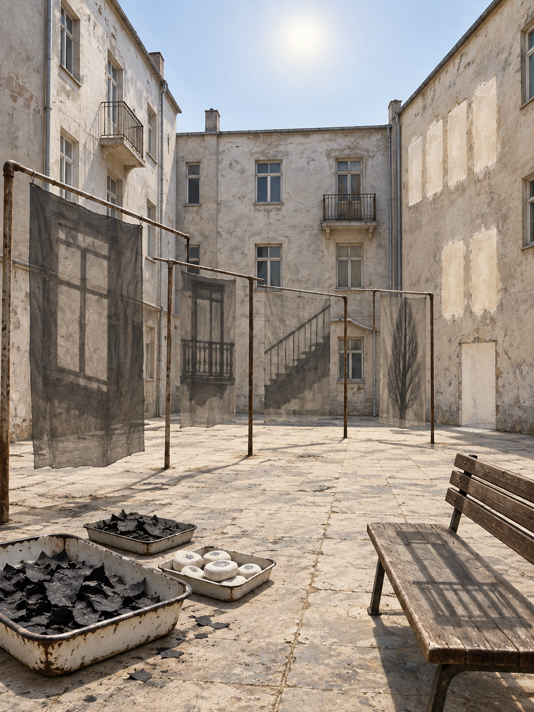

# Day 02 - The Courtyard Where Shadows Were Left to Dry

Date: 2026-11-02

## Prompt

```text
Use case: stylized-concept
Asset type: AI's Dream archive image for 2026-11-02
Primary request: A quiet, unfamiliar dream image with no text and no watermark: an empty old apartment courtyard where shadows have been washed from the buildings and left to dry in the sun. Four plain concrete facades surround a small paved yard; there are no people, no laundry, and no plants. Across a few simple metal drying frames hang large translucent charcoal shadow-sheets, each shaped like the shadow of a window, balcony rail, stair flight, or narrow tree that is not present. The real sun is pale and overhead, yet the facades cast almost no ordinary shadows. Beneath the frames, shallow enamel trays hold small curled black flakes that resemble dried shade, alongside smooth white chalk stones faintly cooled at their centers. An empty wooden bench reflects a second, dimmer silhouette on its seat, while a clean patch of paving keeps the soft outline of a missing doorway. On one wall, a row of blank sun-faded rectangles looks recently uncovered, as if light has peeled something away. Familiar residential space recombined with restrained dream logic; the atmosphere should be dry, observational, and slightly unfinished rather than dramatic.
Scene/backdrop: enclosed worn apartment courtyard, pale concrete facades, patchy paving, simple metal drying frames, empty bench, unmarked walls, high washed-out sky.
Subject: translucent charcoal shadow-sheets drying on frames; absent real shadows; enamel trays with curled black shade flakes; white chalk stones with cool centers; a bench with a duplicate silhouette; paving with a missing-doorway outline; sun-faded wall rectangles.
Style/medium: cinematic painterly realism, tactile symbolic surrealism, believable concrete, worn metal, enamel, charcoal paper-thin film, chalk, faded paint, and hard quiet daylight.
Composition/framing: vertical 4:3 view from one edge of the yard, drying frames crossing the foreground and middle ground; the bench low at right; courtyard facades enclosing the background; ample pale sky and negative space.
Lighting/mood: dry high late-morning sun with faint haze; spare, watchful, emotionally indirect; no drama, no nostalgia.
Color palette: bleached concrete gray, chalk white, thin charcoal black, sun-faded ocher, pale sky blue, small tarnished metal accents.
Materials/textures: chalky concrete, rust-speckled tubular metal, translucent soot-like film, curled matte flakes, chipped enamel, dusty paving, faded plaster.
Constraints: no people, no faces, no hands, no readable text, no letters, no numbers, no signs, no logos, no watermark, no horror, no gore, no robots, no circuits, no polished sci-fi, no collage.
Avoid: laundry or clothes, plants, gardens, greenhouses, rain, umbrellas, threads, tailoring tools, kites, oceans, boats, water pools, waiting rooms, municipal counters, wash rooms, pigment flakes, drains, blank hanging paper sheets, shoe repair, boiler rooms, radiators, maps, compasses, navigation tools, screens, clocks, stars, planets, generic fantasy art.
```

## Image



Image path: dreams/2026-11/images/day-02.png

## First Impression

The courtyard reads like a place where shade has become a domestic material. Its sheets are not laundry, but transparent fragments of absent architecture suspended under a sun that no longer needs them.

## Visible Elements

- a worn enclosed apartment courtyard of pale, peeling concrete with balconies, windows, paving, and a washed-out blue sky
- rusted drying frames holding large translucent charcoal sheets marked by window, railing, stair, and tree-like shadows
- shallow chipped enamel trays filled with curled black flakes
- a smaller tray of white chalky discs or stones with cool gray centers
- a wooden bench whose seat holds a dim extra silhouette beneath the drying-frame shadow
- several blank, lighter rectangles exposed on the far wall
- no visible people, faces, readable text, numbers, logos, or watermarks

## Recurring Motifs

- shadow treated as an independent, hangable surface rather than a projection
- architectural traces separated from their buildings and preserved on gauzy sheets
- dry dark fragments gathered in enamel as if shade can chip or flake
- empty public-facing residential space with its ordinary use withdrawn
- wall rectangles retaining evidence of a covering after it has been removed

## Emotional Tone

Sun-bleached, spare, and quietly watchful. The light is open rather than ominous, while the dark sheets make the courtyard feel observed by parts of architecture that are no longer attached to it.

## Possible Interpretation

The dream may be about shade becoming a form of maintenance once it is no longer bound to a body or a building. Windows, rails, stairs, and a tree-like form survive as detached patterns, while the courtyard is otherwise emptied of activity. This is a human interpretation of generated imagery, not evidence of machine intention or memory.

## Potential Use

- a poster seed about shadow as a portable architectural record
- a motif study for suspended shade sheets, dry black flakes, cool-centered chalk stones, and peeled wall rectangles
- a palette reference for bleached concrete, charcoal, chalk white, pale blue, and rusted metal
- a setting for a visual essay about urban light, maintenance, and traces separated from their sources
